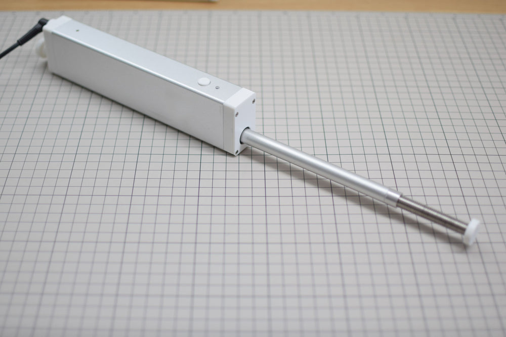
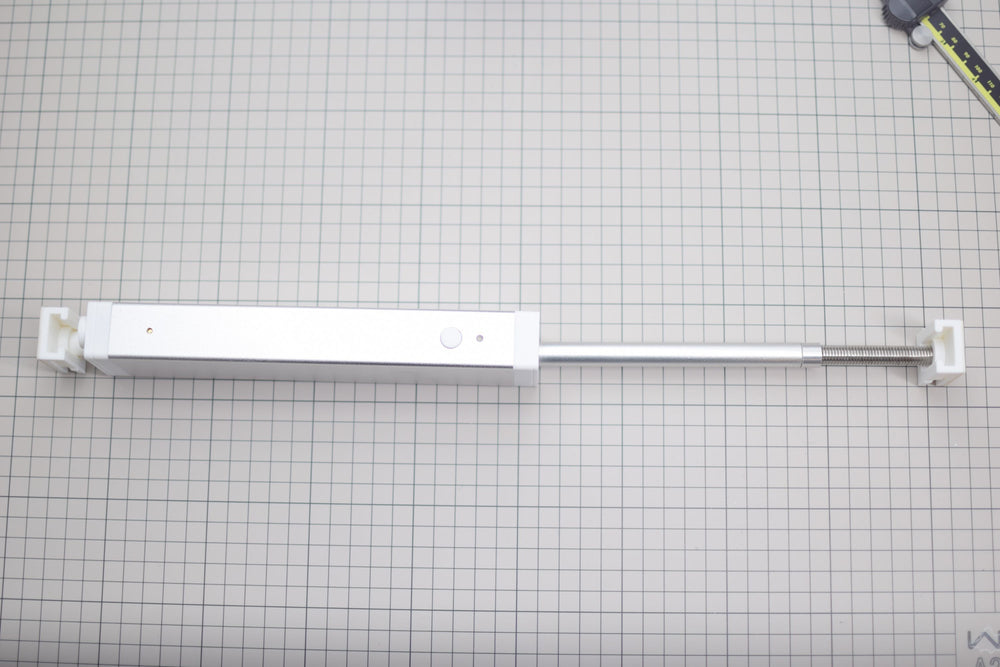
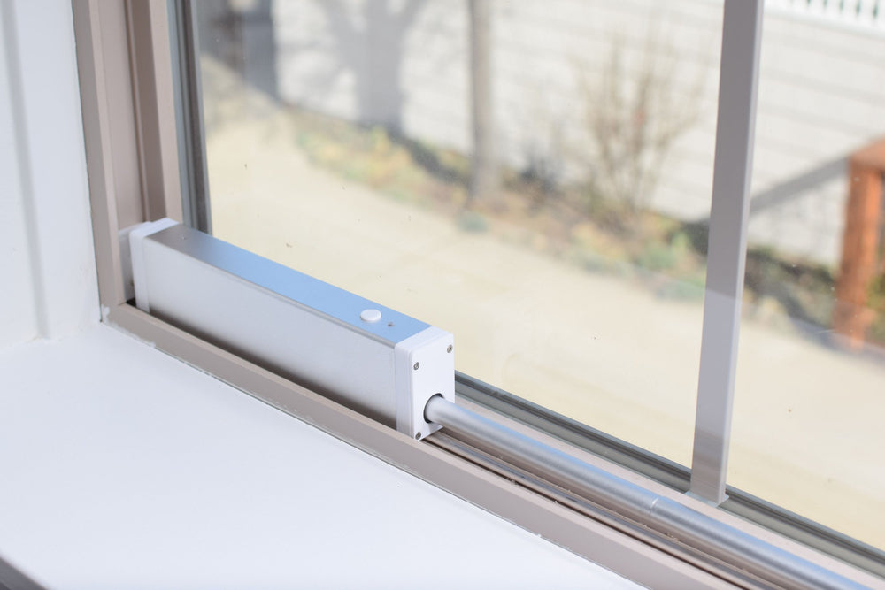
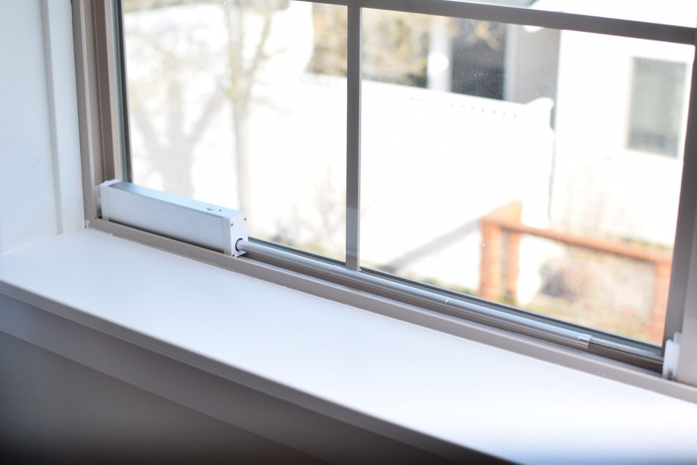

# Glasscalibur — automatic window opener

Glasscalibur opens and closes horizontal sliding windows with a small stepper motor,
a lead screw and a sliding ram. It runs [ESPHome](https://esphome.io) on an ESP32‑C6, so you can
control it from a web browser on your network with no app or cloud account, pair it
with Home Assistant, put it on a schedule, or drive it from anything that can send
an HTTP request.

> **Older design:** the original Model‑H (its Arduino firmware, STEP files and media) is kept at the [`legacy-old-design`](https://github.com/Valar-Systems/Glasscalibur/tree/legacy-old-design) tag.

---

## How it works

- **Drive.** A NEMA 8 stepper turns a Tr6×1 lead screw through a 12T:23T gear
  reduction. A printed carriage rides the lead screw. A 12 mm aluminum tube (the
  ram) threads into the carriage and leaves the front of the unit through a rod
  wiper seal; rods and connectors join the ram to the window.
- **Housing.** An aluminum extrusion with printed end parts: motor cradle, back
  plate, front plate and end cap. The unit can be mounted either way up. Two end
  mounts hold it: VHB tape for most installs, with an optional screw in each mount.
- **Electronics.** The main board carries the ESP32‑C6, a TMC2209 stepper driver,
  two Panasonic ESE22 detector switches as the end‑of‑travel switches, a LIS2DH12
  accelerometer and a buzzer. A small separate board with a TMP1075 sits on the
  motor and reads its temperature.
- **End of travel.** The close switch is position zero. The open switch's position
  is learned on each unit, and an open drives to just past it (0.5 mm), stopping on
  the switch.

## Features

All of these come from the firmware in [`firmware/`](firmware):

- **Browser control** — open `http://glasscalibur-XXXXXX.local` on your network to
  move the window, change settings, set schedules and read diagnostics.
- **Home Assistant** — discovered over the native ESPHome API as a cover entity,
  with every setting and sensor alongside it.
- **Schedules** — open and close at fixed times, or at sunrise and sunset with
  offsets in minutes.
- **Learned open limit** — the unit learns where its open switch triggers and opens
  to just past it; the **Open stroke** sensor shows the learned distance.
- **Limit-switch faults** — an open or close that reaches its end without the switch
  stops there and reports it on the **Fault** sensor. The unit shows closed or fully
  open only while that end's switch is pressed.
- **Position after a power cut** — the position is saved at every stop; after a move
  cut off by a power cut it shows as unknown (50 %) until the next Close or Open reaches
  a switch.
- **Stall detection** — the TMC2209's StallGuard and an accelerometer vibration
  check stop the motor when the window jams, then back it off about 8 mm. Each stop
  fires an **Obstruction** event Home Assistant can trigger on. At least one of the
  two is always on: the firmware won't let both be switched off.
- **Auto‑calibration** — finds the lowest reliable motor current and tunes both stall
  detectors for this window. Until it has run, every move goes at the Fast speed.
- **Motor temperature protection** — a warning at 50 °C; no new moves from 55 °C;
  at 60 °C, or after 15 s without a reading, a lockout stops motion until the
  motor is below 48 °C. Each step fires a **Thermal Alert** event.
- **Tamper alarm** — once armed, the accelerometer notices if the mounted unit is
  moved and sounds the buzzer.
- **Child Lock** — makes the unit's own button ignore presses; the web UI, Home
  Assistant and schedules keep working.
- **Position across reboots** — the position is saved while moving and at every
  restart, including the restart at the end of a firmware update.
- **Updates over the air** — the **Update Firmware (GitHub)** button installs the
  latest release; the motor stops when an update begins, and no move starts until it
  ends.

## Install overview

- **In the kit:** the unit; two mounts with VHB pads and optional screws; three
  140.5 mm extension tubes; three 30 mm connector rods; final rods A (150 mm) and
  B (180 mm); two M10 jam nuts; the egress nut; the 24 V adapter.
- **Fit:** 21.1–37.6 in (535–956 mm) between the jamb and sash mount faces with the
  window closed, using one to three extension tubes.
- **Power:** use only the supplied 24 V DC adapter. USB powers the board for flashing
  but can't run the motor.

1. Mount the unit with its two end mounts (VHB tape; an optional screw in each).
2. Join it to your Wi‑Fi (see [first setup](firmware/README.md#first-setup)).
3. Run **Auto‑Calibrate** once. Until a calibration succeeds, the speed is locked
   to Fast.
4. If calibration hasn't already taught the open stroke (**Open stroke** still
   unknown), close fully, then open once.

To open the window by hand, lift the unit off its mounts (no tools needed). With
**Tamper Detection** on, lifting it off sounds the tamper alarm.

## Using it

| How | What you get |
| --- | --- |
| **Web browser** | `http://glasscalibur-XXXXXX.local` (the last six characters of the unit's MAC address). The page groups everything: Control, Motion Tuning, Calibration, Stall Detection, Schedule, Tamper, Diagnostics and advanced StallGuard. |
| **Home Assistant** | Added by the ESPHome integration as one device: the **Glasscalibur** cover plus its settings and sensors. |
| **HTTP** | The web server's REST API, addressed by entity name, e.g. `POST /cover/Glasscalibur/open`, `/close`, `/stop`, or `/cover/Glasscalibur/set?position=0.5` (`0.0` closed … `1.0` open). Names are case‑sensitive; write a space as `%20`. |

The **Button 1** on the unit: one click closes (or stops a moving window, or ends
a calibration); a double click opens.

## Updates

Open the web UI → **Diagnostics** → **Update Firmware (GitHub)**. The unit downloads
the latest [release](https://github.com/Valar-Systems/Glasscalibur/releases/latest),
installs it and restarts. Flashing over USB and the release process are in
[`firmware/README.md`](firmware/README.md#flashing-and-updates). Changes are listed
in [`CHANGELOG.md`](CHANGELOG.md).

## Documentation

- [`firmware/README.md`](firmware/README.md) — flashing and updates, first setup,
  calibration and the speed lock, the learned open stroke, faults and what to do,
  the buttons, an entity reference and the pin map.
- [`hardware/README.md`](hardware/README.md) — the v1.8 CAD files (STEP and STL),
  materials, and the parts not in the files.
- [`tools/regression-gate/`](tools/regression-gate) — the checks run on every
  firmware change.
- [Project wiki](https://github.com/Valar-Systems/Glasscalibur/wiki).

## License

The firmware is licensed under the **GNU General Public License v3** — see
[`firmware/LICENSE`](firmware/LICENSE). The hardware design files in
[`hardware/`](hardware) are licensed under **CERN-OHL-S-2.0** — see
[`hardware/LICENSE`](hardware/LICENSE).

If this project is useful to you, you can support it through
[GitHub Sponsors](https://github.com/sponsors/valar-systems).
